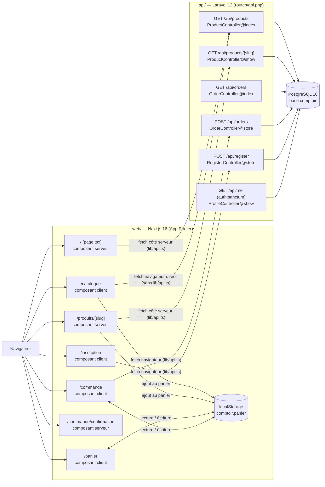
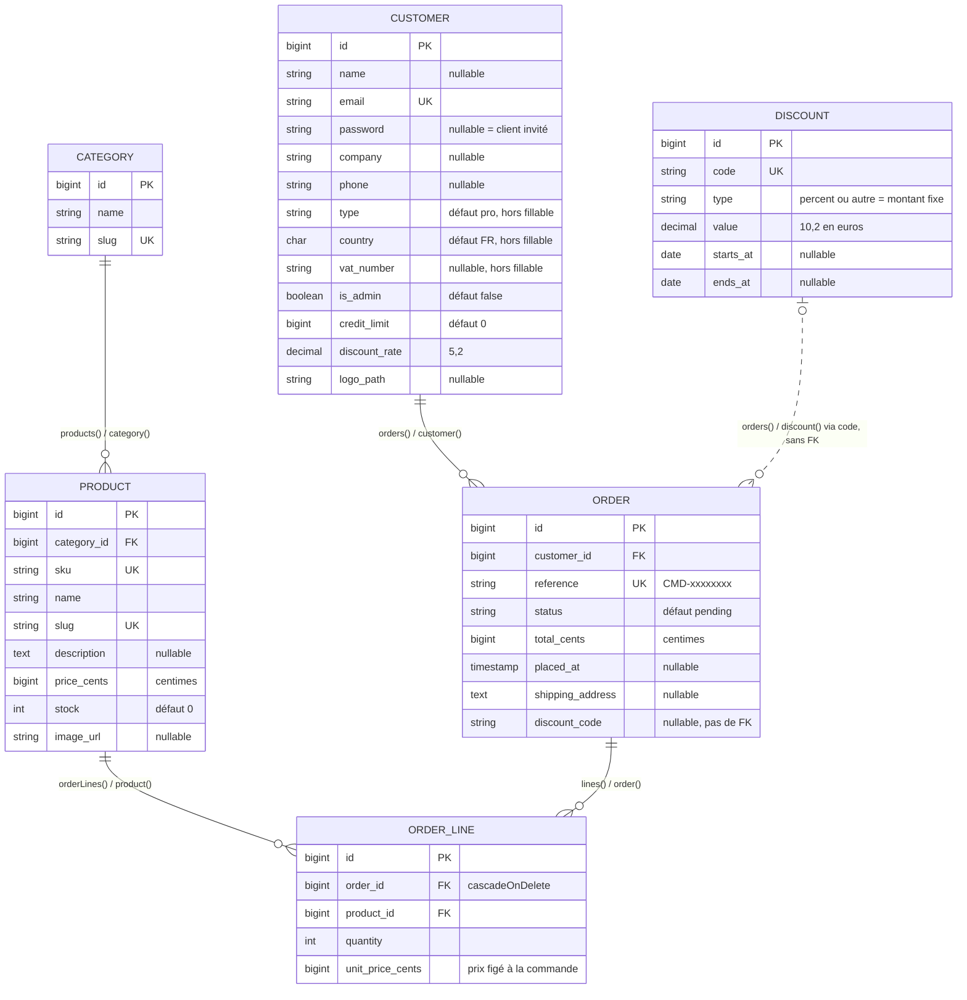
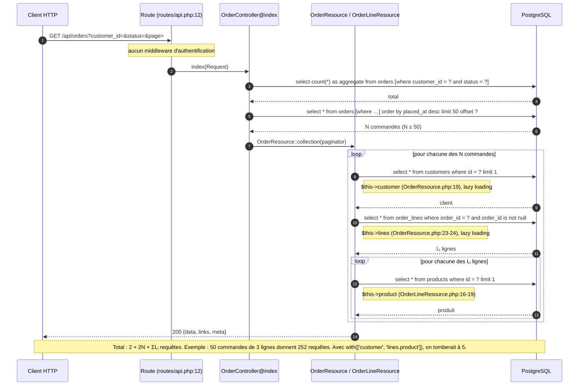

# Architecture de Comptoir

Document établi à partir de la lecture du code (commit `3580b0a`). Ce qui est déduit sans être visible dans le code est signalé par **[supposé]**.

## 1. Vue d'ensemble

À propos de ce schéma :

- **Aucun appel à l'API** : `/panier` et `/commande/confirmation`. La confirmation se contente d'afficher le paramètre `?reference=` (`web/app/commande/confirmation/page.tsx:8-25`).
- **Endpoints que le front n'appelle jamais** : `GET /api/orders` et `GET /api/me`. Aucune référence n'apparaît dans `web/`.
- **Endpoints protégés** : seul `GET /api/me` passe par un middleware d'authentification (`api/routes/api.php:17-19`). `GET /api/orders` et `POST /api/orders` sont publics.
- **Autres routes, hors schéma** : `GET /` (`api/routes/web.php:5`), `GET /up` (`api/bootstrap/app.php:13`) et la commande `php artisan invoices:export {order}`.

## 2. Modèle de données

Sources de chaque relation : méthode Eloquent d'un côté, contrainte de migration de l'autre.

| Relation | Côté Eloquent | Contrainte en base |
|---|---|---|
| Category 1–n Product | `Category.php:18`, `Product.php:33` | FK `products.category_id` (`create_products_table.php:13`) |
| Product 1–n OrderLine | `Product.php:38`, `OrderLine.php:35` | FK `order_lines.product_id` (`create_order_lines_table.php:14`) |
| Customer 1–n Order | `Customer.php:38`, `Order.php:53` | FK `orders.customer_id` (`create_orders_table.php:13`) |
| Order 1–n OrderLine | `Order.php:58`, `OrderLine.php:30` | FK `order_lines.order_id` avec suppression en cascade (`create_order_lines_table.php:13`) |
| Discount 0..1–n Order | `Discount.php:30`, `Order.php:63` | **Aucune FK** : jointure sur `orders.discount_code = discounts.code`, et le code n'est pas validé (`StoreOrderRequest.php:27`). La relation est donc tracée en pointillé. |

Ce que le code ne montre pas :

- **Pas de relation Customer ↔ Discount.** `customers.discount_rate` existe, mais aucun code ne le lit.
- **Aucune relation pour `personal_access_tokens`** (table Sanctum, `morphs('tokenable')`) : ce n'est pas un des 6 modèles.
- **« Au moins une ligne par commande » n'est pas garanti en base.** Seule la validation l'impose (`StoreOrderRequest.php:23`), c'est pourquoi le schéma indique `o{` et non `|{`.
- **Pas de type énuméré pour `status` ni pour `type`.** Les valeurs `pending | paid | shipped | cancelled` ne figurent que dans `web/types/api.ts:32`.

## 3. Séquence de `GET /api/orders`

Le compte de requêtes s'appuie sur deux sources.

**Ce que j'ai lu dans le code :**

- le contrôleur n'appelle ni `with()` ni `load()` (`OrderController.php:22-30`) ;
- la Resource lit `customer`, `lines` et `product` (`OrderResource.php:19-24`, `OrderLineResource.php:16-19`).

**Ce que je suppose, d'après le comportement standard de Laravel :**

- **Requêtes émises :**
  - `paginate()` lance d'abord le `count(*)`, puis le `select` paginé ;
  - le texte SQL exact est celui que générerait Eloquent pour PostgreSQL. Je ne l'ai pas capturé en exécutant.
- **Cas qui changent le total :**
  - si le `count` renvoie 0, Laravel saute le second `select` ;
  - une relation déjà chargée ne déclenche pas de nouvelle requête. C'est le cas quand `OrderResource` relit `$this->customer` trois fois, ou quand `lines->count()` compte la collection déjà en mémoire.

## 4. Points fragiles

| Zone | Constat | Risque |
|---|---|---|
| Stock | Le contrôle de stock compare chaque ligne au stock initial (`api/app/Services/OrderService.php:29-35`), puis les décréments s'additionnent (`:56`). Un même `product_id` sur deux lignes passe le contrôle. | Stock négatif. `unsignedInteger` ne crée pas de contrainte `CHECK` en PostgreSQL **[supposé]** (`create_products_table.php:19`). |
| Montants : commande | `discount_code` est enregistré (`OrderService.php:42`) mais ignoré dans le total (`:58`). `total_cents` n'inclut ni TVA ni port. | Le total de la commande diffère de celui de la facture. Un code promo inexistant est accepté (`StoreOrderRequest.php:27`). |
| Montants : invités | Les invités sont créés avec `type='pro'` et `country='FR'` en dur (`OrderService.php:92-93`). | Remise pro de 3 % appliquée à tort (`LegacyInvoiceCalculator.php:91`) et TVA FR quelle que soit l'adresse. |
| Montants : facture | Calcul en euros `float` (`InvoicePdfExporter.php:31`, `LegacyInvoiceCalculator.php:48`). La remise répartie n'est pas arrondie (`:130`) alors que la TVA est arrondie par taux (`:132`). | Écarts de centimes entre lignes, TVA et total TTC. |
| Montants : remise quantité | La condition `qty >= 10` est testée avant `qty >= 50` (`LegacyInvoiceCalculator.php:50-53`). | La remise de 10 % n'est jamais appliquée. |
| Montants : TVA UE | La liste UE est incomplète (`LegacyInvoiceCalculator.php:42`, il manque notamment PL, SE, DK, CZ). Elle diffère de celle de `isEuCountry` (`:243`, qui inclut GB et exclut GR). | Mauvais taux de TVA (0 % au lieu de 20 %) pour une partie des clients de l'UE. |
| Montants : remise fixe | Valeur décimale lue sous forme de chaîne et non arrondie (`LegacyInvoiceCalculator.php:104`). | Imprécision des montants. |
| Facture : état partagé | L'export lit `$calculator->lastResult` au lieu de la valeur de retour (`InvoicePdfExporter.php:36-37`). | Couplage fragile : une refonte du calculateur peut casser l'export sans erreur visible. |
| Facture : format | Fichier texte entouré de `%PDF-1.4` / `%%EOF` (`InvoicePdfExporter.php:39-67`). | Fichier probablement illisible par un lecteur PDF **[supposé]**. |
| Performance : liste des commandes | N+1 : aucun eager loading (`OrderController.php:22-30`). Voir §3. | 2 + 2N + ΣLᵢ requêtes par page. |
| Performance : index | Aucun index sur `orders.customer_id` (`create_orders_table.php:13`), `status` (`:15`) ni `placed_at` (`:17`). PostgreSQL n'indexe pas les FK automatiquement **[supposé]**. | Parcours complet de la table pour filtrer et trier, de plus en plus lent avec le volume. |
| Performance : produits | `GET /api/products` renvoie tout, sans pagination (`ProductController.php:17-20`). | Réponse qui grossit avec le catalogue. |
| Concurrence : verrous | `lockForUpdate` sur `whereIn` sans `orderBy` (`OrderService.php:23-26`). | Interblocages entre commandes simultanées **[supposé]**. |
| Concurrence : référence | La référence est vérifiée puis insérée sans atomicité (`Order.php:46-48`). | Erreur 500 sur la contrainte unique, très peu probable. |
| Sécurité : lecture | `GET /api/orders` est public (`routes/api.php:12`). | Fuite de toutes les commandes, avec le nom et la société des clients. |
| Sécurité : écriture | `POST /api/orders` est public et accepte n'importe quel `customer_id` (`routes/api.php:13`, `StoreOrderRequest.php:17`). | N'importe qui peut passer commande au nom d'un autre client. |
| Sécurité : invités | Un invité existant est réutilisé sur la seule base de son e-mail (`OrderService.php:82-84`). | Rattachement de commandes au client invité d'un tiers. |
| Tests : facturation | Aucun test pour `LegacyInvoiceCalculator`, `InvoicePdfExporter` ni `ExportInvoice`. Le seul test Unit est factice (`api/tests/Unit/ExampleTest.php:3`). | Régressions silencieuses sur les montants facturés. |
| Tests : commandes | `api/tests/Feature/OrderTest.php` ne couvre ni les lignes en doublon, ni `discount_code`, ni la concurrence. | Les bugs de stock et de remise ci-dessus ne sont pas détectés. |
| Tests : CI | La CI lance seulement Pint, ESLint et `tsc` (`.github/workflows/lint.yml`). | Les tests Pest, Vitest et Playwright ne s'exécutent jamais automatiquement. |
| Tests : e2e | Un seul scénario e2e, sur le catalogue (`web/e2e/catalogue.spec.ts`). | Parcours de commande non testé de bout en bout. |
| Front : quantités | `Number(...)` sans contrôle (`web/components/CartView.tsx:48`, `web/components/AddToCartForm.tsx:16`). | Quantité 0 ou `NaN` dans le panier, puis commande refusée par l'API (`min:1`). |
| Front : catalogue | Appel `fetch` direct sans gestion d'erreur, qui contourne `lib/api.ts` (`web/app/catalogue/page.tsx:23-28`). | Affichage bloqué sur « Chargement… » en cas d'échec ; URL `undefined/api/products` si la variable d'environnement manque. |
| Front : affichage prix | Prix affiché avec `toFixed(2)` (`web/app/catalogue/page.tsx:53`) au lieu de `formatPrice`. | Format « 12.50 € » incohérent avec le reste du site (« 12,50 € »). |
| Front : panier | `parseCart` accepte n'importe quel tableau (`web/lib/cart.ts:51`). | Panier corrompu affiché sans contrôle ; prix éventuellement périmés (affichage uniquement, l'API recalcule). |
